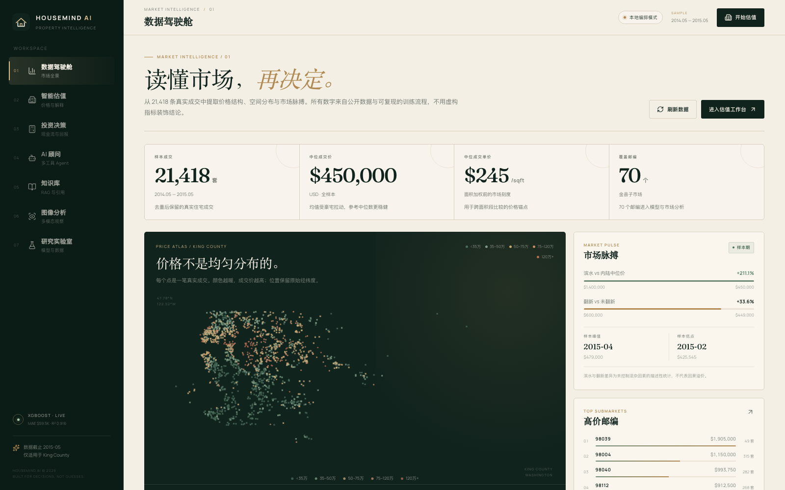
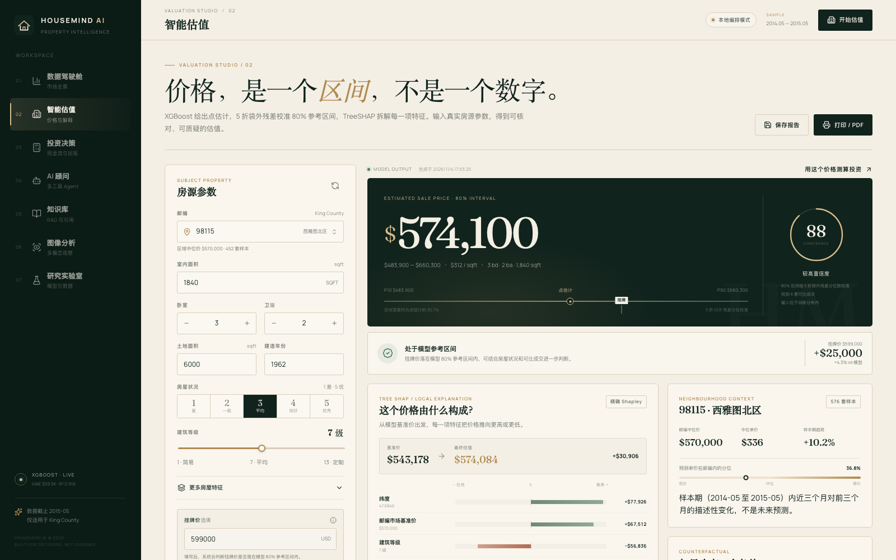
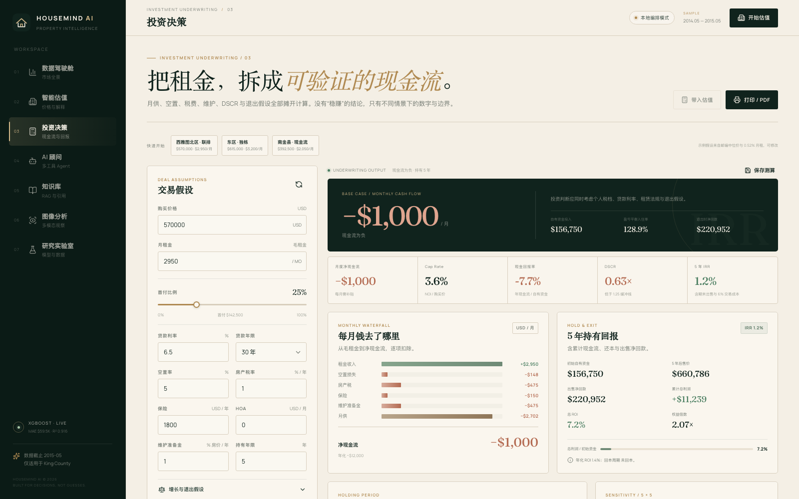
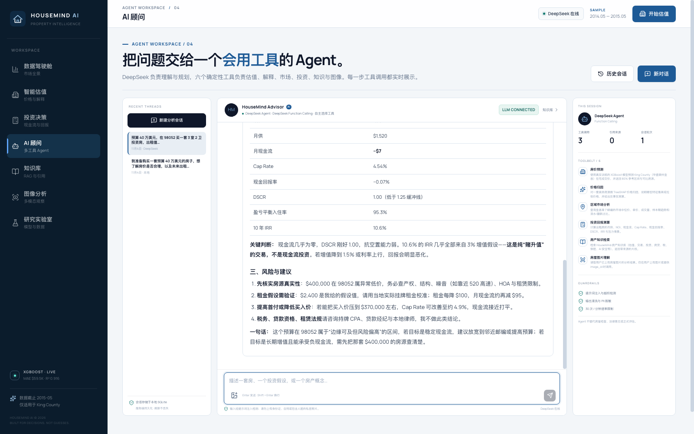
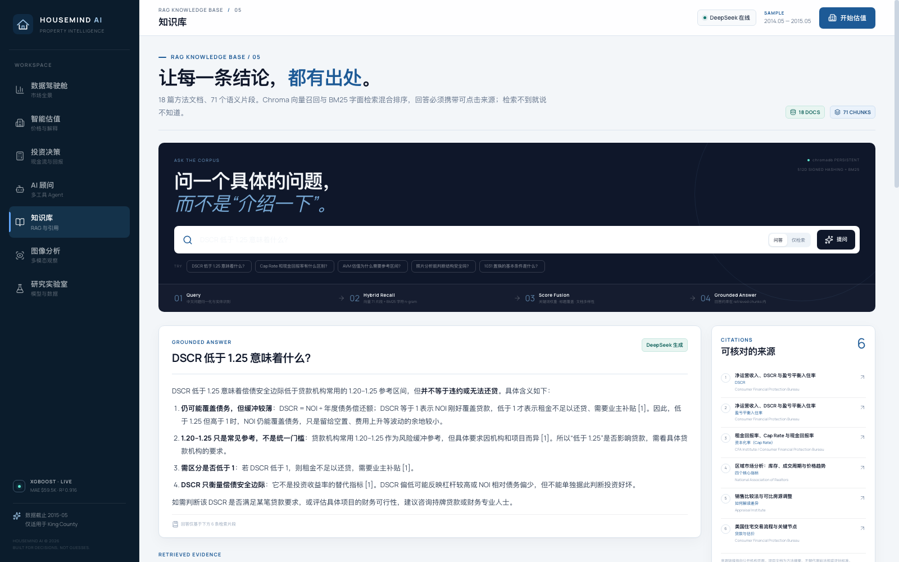
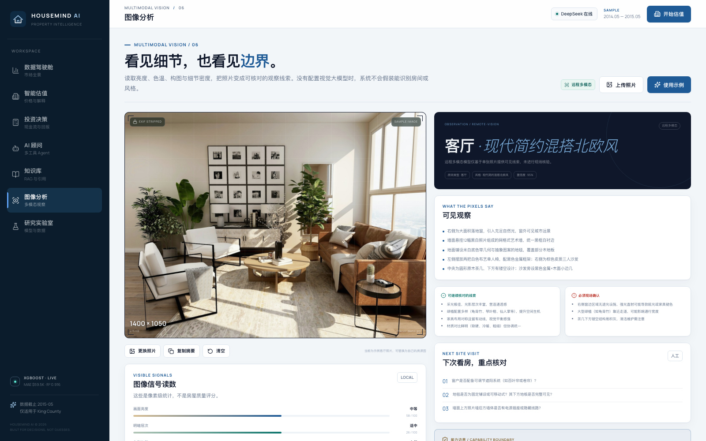
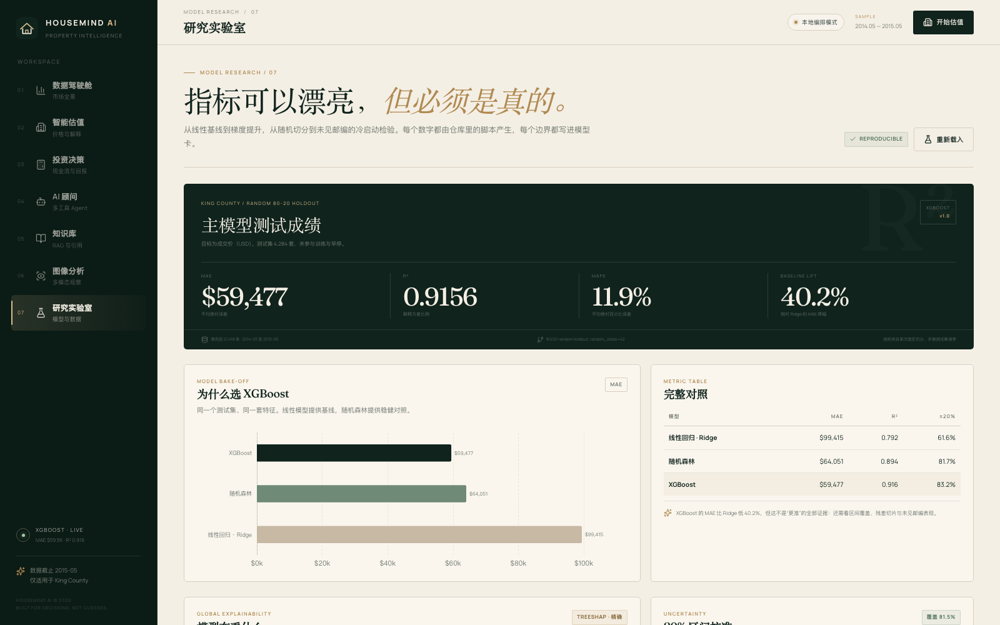
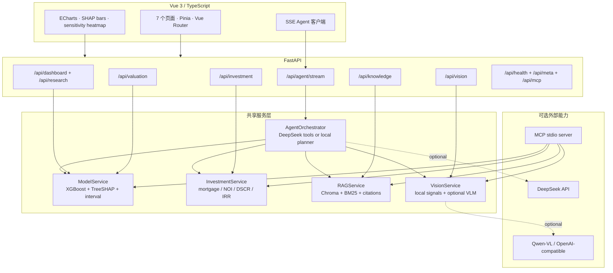

# HouseMind AI

**以模型为估值基础，以 Agent 为决策入口。**

一个面向美国华盛顿州金县（King County）住宅的 AI 估值与投资决策工作台。它不是“输入面积、输出一个价格”的玩具，而是把 **真实成交数据、可解释模型、概率区间、现金流测算、RAG 引用、多模态观察与 Agent 工具链** 放进同一条可核对的决策路径。

> 历史成交样本：2014-05 至 2015-05 · 美元计价 · 仅适用于 King County  
> 这不是正式评估、贷款审批或投资建议。所有输出都附带数据范围、误差与能力边界。



## 为什么做这件事

房产决策的核心矛盾不是“缺一个价格”，而是：

- 价格是一个区间，不是精确数字；
- 模型说得出价格，却说不清为什么；
- 投资判断需要把月供、空置、税费、维护、DSCR 与退出假设摊开；
- 大模型会编造，知识库必须给出处；
- 图片能提供线索，但不能替代房屋检查；
- 一个 Agent 会调工具，比一个会聊天的模型更有用。

HouseMind AI 用 **7 个模块** 回答这些问题：

| 模块 | 路由 | 解决的问题 |
|---|---|---|
| 数据驾驶舱 | `/` | 市场结构、空间价格、样本质量 |
| 智能估值 | `/valuation` | 点估计、80% 区间、TreeSHAP 归因、可比成交 |
| 投资决策 | `/investment` | 月供、NOI、Cap Rate、CoC、DSCR、IRR、情景与敏感性 |
| AI 顾问 | `/agent` | 6 个真实工具的 SSE Agent，带完整工具轨迹 |
| 知识库 | `/knowledge` | Chroma + BM25 混合检索、引用、文档阅读 |
| 图像分析 | `/vision` | 本地图像信号 + 可选视觉大模型 + 能力边界 |
| 研究实验室 | `/research` | 模型对比、全局 SHAP、泛化检验、模型卡 |

> 对照最初方案：**模块 02 预测 + 模块 03 价值解释**合并到 `/valuation`（点估计、区间、局部 SHAP、可比成交）；`/research` 是附加的模型验证页，不替代模块 03。这样 7 个路由覆盖了原方案的 7 个能力模块，并额外提供研究验证页。

## 团队信息

> 提交前请替换为真实信息；公开版本不要填写手机号、邮箱等隐私信息。

| 项目 | 内容 |
|---|---|
| 学校 | 待填写 |
| 队伍名称 | 待填写 |
| 参赛组别 | A组 / B组 / C组 / 研究生组（按实际填写） |
| 成员 | 待填写（1–3 人，注明分工） |
| 指导教师 | 待填写（不超过 2 人） |

## 核心结果（全部来自仓库脚本）

### King County 主模型

测试集为固定随机 80/20 holdout，4,284 套，未参与训练与早停。

| 模型 | MAE | RMSE | R² | MAPE | 误差 ±20% 内 |
|---|---:|---:|---:|---:|---:|
| Ridge 线性基线 | $99,414.81 | $158,642.52 | 0.7916 | 20.45% | 61.6% |
| Random Forest | $64,051.47 | $113,126.89 | 0.8940 | 12.58% | 81.7% |
| **XGBoost** | **$59,477.26** | **$100,985.85** | **0.9156** | **11.91%** | **83.2%** |

- XGBoost 相对 Ridge 的 MAE 降低 **40.2%**。
- 80% 参考区间：Q10 **−$90,229** / Q90 **+$86,242**，测试集实测覆盖 **81.5%**，中位宽度 **$176,470**。
- 区间由 **5 折 out-of-fold 残差分位数** 校准，不假设正态分布。
- 误差切片使用测试集前 **800 套**固定预览样本；总体 MAE / R² / 覆盖率仍使用全部 **4,284 套**。

### 泛化与独立数据集

| 检验 | 结果 | 说明 |
|---|---|---|
| 未见邮编 GroupShuffleSplit | MAE **$95,130.23**，R² **0.7814** | 14 个邮编完全未出现；冷启动下界 |
| UCI 新店区 holdout | MAE **3.70**，R² **0.8305** | 目标为万元新台币/坪，不可与美元 MAE 比较 |
| California Housing holdout | MAE **$29,382.88**，R² **0.8472** | 1990 年普查中位房价，500k 处封顶 |

> 三个数据集地区、年代、币种与目标定义不同，**禁止横向比较绝对误差**。研究页与模型卡都明确写出这一点。

### RAG 检索（小型人工 gold set）

20 个领域问题、4 个明显超纲问题：

- Hit@1 **100%**（20/20，按“期望章节/内容是否出现在 Top-1”判定）
- Hit@3 **100%**
- 超纲拒答率 **100%**（4/4）
- 知识库：**18 篇方法文档、71 个语义片段**

这是内部小样本检索评测，不是公开 benchmark；问题与判定标准在 [`ml/evaluate_rag.py`](ml/evaluate_rag.py)。

## 界面

| 估值：区间、置信度与 SHAP | 投资：现金流与 DSCR |
|---|---|
|  |  |

| Agent：真实工具轨迹 | 知识库：回答必须带引用 |
|---|---|
|  |  |

| 图像：可见信号与边界 | 研究：模型卡与泛化 |
|---|---|
|  |  |

## 架构



### 为什么 Agent 不是“套壳聊天”

- **6 个真实工具**：房价预测、价格归因、区域市场、投资测算、知识检索、图片理解。
- **两种模式**：配置 `DEEPSEEK_API_KEY` 时走 Function Calling；没有密钥时走**确定性本地规划器**，仍然调用同一批工具、发出同样的事件流，不假装有 LLM。
- **SSE 事件**：`meta → status → tool_call → tool_result → token → citations → done`。
- **可追溯**：每次工具调用的参数、摘要、耗时写入 SQLite，刷新后仍能看到轨迹。
- **安全**：提示词注入检测、canary、输出清洗、PII 脱敏、速率限制、上传校验与 EXIF 移除。

## 快速开始

### 环境

- Python **3.13**
- Node.js **20.19+**（推荐 22）与 pnpm
- macOS / Linux / Windows（推荐 Linux 或 macOS）

### 1. 安装依赖

```bash
python3.13 -m venv .venv
.venv/bin/pip install -r backend/requirements.txt

cd frontend
pnpm install
pnpm build
cd ..

cp .env.example .env
```

### 2. 启动

```bash
.venv/bin/python -m uvicorn backend.main:app --host 127.0.0.1 --port 8000
```

打开 **http://127.0.0.1:8000**。API 文档在 **http://127.0.0.1:8000/docs**。

也可以使用：

```bash
./scripts/bootstrap.sh   # 首次安装
./scripts/dev.sh         # 后端 8000 + Vite 5173 热更新
./scripts/start.sh       # 单端口生产式启动
```

### 3. 可选能力

```bash
# DeepSeek：启用真实 Function Calling Agent
DEEPSEEK_API_KEY=sk-...

# Qwen-VL：启用远程视觉语义分析（房间类型、风格、材质）
VISION_API_KEY=...
VISION_MODEL=qwen-vl-max
```

不配置任何密钥时，系统完整可用：**本地规划器 + 本地图像信号 + 本地抽取式 RAG 回答**。界面会明确显示当前模式，不会把本地规则伪装成大模型。

### 4. 重建视频与 PDF（可选）

```bash
.venv/bin/pip install -r requirements-dev.txt
.venv/bin/python scripts/build_demo_video.py
./scripts/build_pdf.sh
```

视频使用本机 `say` 中文旁白与真实 UI 截图合成，不伪造运行状态；PDF 由 `docs/technical_doc.html` 通过 Chrome 打印生成。

### 5. Docker

```bash
docker compose up --build
```

访问 `http://127.0.0.1:8000`。SQLite、Chroma 与上传文件保存在 `housemind-data` volume。

### 6. 可选：启用远程模型

默认无需密钥。若要启用 DeepSeek Agent 或 Qwen-VL：

```bash
cp .env.example .env        # 已存在则跳过
# 编辑 DEEPSEEK_API_KEY / VISION_API_KEY
.venv/bin/python scripts/check_remote.py
```

完整字段、验证方法与安全边界见 [远程模型配置](docs/REMOTE_MODELS.md)。

### 7. 推送到公开仓库

仓库已在本地完成多次有意义的提交（按数据、ML、API、Agent、前端、测试、文档拆分）。替换为你的 GitHub/Gitee 地址后执行：

```bash
git remote add origin https://github.com/<your-account>/housemind-ai.git
git push -u origin main
```

推送前再跑一次 `git status` 与 `git grep -n "sk-"`，确认没有 `.env`、密钥或 `backend/data` 被跟踪。公开仓库建议开启 Issues，并在 About 中填写在线地址（如已部署）。

## 复现训练与评测

```bash
./scripts/train.sh
```

或分步：

```bash
.venv/bin/python ml/train.py          # 3 个数据集、3 个模型、OOF 区间
.venv/bin/python ml/explain.py        # 全局 TreeSHAP + 模型卡
.venv/bin/python ml/build_dashboard.py
.venv/bin/python ml/evaluate.py       # 误差切片 + 诊断图
.venv/bin/python ml/compare_models.py # 未见邮编泛化
.venv/bin/python ml/evaluate_rag.py   # RAG gold set
```

产物写入 `ml/artifacts/` 与 `ml/reports/`。仓库已包含训练好的模型与指标，克隆后可直接启动。

## 测试

```bash
.venv/bin/python -m pytest tests -q
```

当前 **25 个测试**，覆盖：

- 估值输出、区间、SHAP 加性关系、输入校验
- 投资月供 / NOI / DSCR / Cap Rate / 情景
- RAG 检索、引用、文档读取、知识库统计
- 图像上传、EXIF 移除、语义边界、非图片拒绝、8 MB 大小限制
- Agent SSE 事件、工具轨迹持久化、注入拦截
- MCP manifest、模型确定性与健康检查
- PII 脱敏、canary 清洗、提示词注入检测

## MCP Server

项目提供真实的 **stdio MCP server**，与 Web Agent 共用同一套工具：

```json
{
  "mcpServers": {
    "housemind-ai": {
      "command": "/absolute/path/to/.venv/bin/python",
      "args": ["/absolute/path/to/backend/mcp_server.py"]
    }
  }
}
```

六个工具：`predict_house_price`、`explain_house_price`、`analyze_market`、`calculate_investment`、`search_property_knowledge`、`analyze_house_image`。  
Web 端可查看 manifest：`GET /api/mcp/manifest`。

## 目录

```
backend/
  app/
    agent/          # 工具注册、编排、SSE、本地规划器
    api/            # FastAPI 路由
    core/           # 配置、数据库、安全
    rag/            # Chroma + BM25 + 引用
    services/       # 模型、投资、视觉
    schemas/
  mcp_server.py
frontend/
  src/
    views/          # 7 个页面
    components/     # 设计系统组件
    api/            # 类型化 API 客户端
    stores/         # Pinia
    styles/
knowledge_base/     # 18 篇 Markdown 方法文档
ml/
  train.py          # 训练、区间、3 数据集实验
  explain.py        # TreeSHAP / 模型卡
  evaluate.py       # 误差切片 / 图表
  compare_models.py # 未见邮编泛化
  evaluate_rag.py   # RAG gold set
  artifacts/        # 模型与指标
  reports/          # 诊断图
Datasets/           # 三个公开数据集
tests/              # pytest
docs/               # 技术文档、截图、演示脚本
```

## 关键设计决策

1. **精确 TreeSHAP，而不是近似解释。** 直接使用 XGBoost `booster.predict(pred_contribs=True)`，避免 `shap` 包与 XGBoost 版本转换误差；逐套房源的贡献值之和等于预测值减基准值。
2. **区间优先于单点。** 5 折 OOF 残差分位数给出不对称 80% 区间；界面同时显示 P10、P90、区间宽度与置信依据。
3. **数据集绝不混训。** King County 用于主估值；UCI 与 California 只做独立验证与区域对照，指标不拼成“平均成绩”。
4. **RAG 有拒答门槛。** 查询词必须与语料有特定术语重叠；明显超纲问题返回“没有找到”，而不是拿最相似的段落硬答。
5. **Agent 不假装有模型。** 无密钥时明确显示“本地规划器”，工具调用与结果仍然真实；有密钥时才显示 DeepSeek 模式。
6. **图像不越界。** 本地模式只读取亮度、色温、色彩、边缘密度；不推断房间类型、风格、结构安全或面积。远程 VLM 也只做可见语义描述。
7. **每个数字可追溯。** 页面展示训练时间、测试集大小、数据截止、模型版本、误差指标与免责声明；报告可保存到 SQLite。

## 评分维度对照

| 评分维度 | 权重 | 本项目证据 |
|---|---:|---|
| AI 技术深度 | 35% | 6 工具 Agent、DeepSeek Function Calling、18 篇/71 片段 RAG、MCP、精确 TreeSHAP |
| 创新性 | 25% | 估值—区间—解释—现金流—知识—Agent 串成可核对决策链；双模式 Agent；边界产品化 |
| 前端工程质量 | 10% | Vue 3 + TypeScript strict、Pinia、ECharts、路由懒加载、代码分割 |
| 实用性 | 10% | 21,418 套真实成交；估值、投资、知识均可复核；负现金流不美化 |
| 用户体验 | 10% | SSE 流式输出、工具轨迹、加载/错误状态、三档响应式检查 |
| 社会价值与商业潜力 | 10% | 降低首次购房信息不对称；公平性说明；不替代专业评估与检查 |

## AI 技术选型与优化

完整论证见 [技术文档](docs/HouseMind_AI_技术文档.pdf) 的 **A2 附录**。核心取舍：

- **XGBoost + 精确 TreeSHAP**：表格数据强、CPU 可训练、贡献值可加性可校验。
- **OOF 残差分位数区间**：不假设正态，测试覆盖 81.5%。
- **DeepSeek + Function Calling**：工具参数可控、轨迹可追溯；无 Key 时确定性本地规划器兜底。
- **Chroma + BM25 + 字符 n-gram**：可离线、可复现、精确词召回强；已标注不是神经语义 Embedding。
- **Pillow + 可选 VLM**：无 Key 也能分析亮度/色温/主色；有 Key 才做房间/风格语义。

## 提交前检查

```bash
git status
git grep -n "sk-" || true
git check-ignore -v .env
.venv/bin/python -m pytest tests -q
cd frontend && pnpm build && cd ..
./scripts/build_pdf.sh
```

检查：`.env` 不在仓库中、历史无真实 Key、测试全绿、PDF 与视频和当前页面一致、README 团队信息已替换。

## 已知限制

- 房价模型基于 **2014–2015 年历史成交**，不能反映 2020 年后的市场变化，也不是当前挂牌价。
- 仅适用于 King County；对美国境外房产、中国购房政策或商业地产不做定价。
- 未见邮编会回退到全局邮编基准，泛化 MAE 明显高于随机切分。
- 图像分析不能判断结构安全、渗漏、霉变、电路、产权或真实装修质量；不能替代持牌房屋检查。
- RAG 的本地 embedding 是字符 n-gram 哈希，不是语义大模型；小型 gold set 的 100% 不代表开放域效果。
- 投资测算是教育性模型，未计个人所得税、资本利得税、1031 置换与地方租赁法规。
- 无 API 密钥时，Agent 是确定性规划器，不具备开放域语言理解能力；界面会明确标注。

## 文档

- [架构与技术决策](docs/ARCHITECTURE.md)
- [AI 技术说明](docs/AI_TECHNICAL.md)
- [创新点与社会价值](docs/INNOVATION.md)
- [演示视频脚本](docs/DEMO_SCRIPT.md)
- [远程模型配置](docs/REMOTE_MODELS.md)
- [提交清单](docs/SUBMISSION_CHECKLIST.md)
- [技术文档 PDF（19 页）](docs/HouseMind_AI_技术文档.pdf)
- [演示视频（5:35 · 1080p）](docs/HouseMind_AI_Demo_1080p.mp4)

## 数据来源与致谢

- King County House Sales（Kaggle / King County GIS 公开数据）
- UCI Machine Learning Repository — Real Estate Valuation Data Set（ID 477）
- California Housing（Scikit-learn / 1990 U.S. Census）
- 方法文档参考 Appraisal Institute、Fannie Mae、CFPB、HUD、IRS、FEMA、Federal Reserve、NAR、OWASP 等公开资料，详见每篇文档 frontmatter 的 `source_url`。

代码以 MIT License 发布；数据集遵循各自原始许可与使用条款，仓库中的副本仅用于可复现实验。
