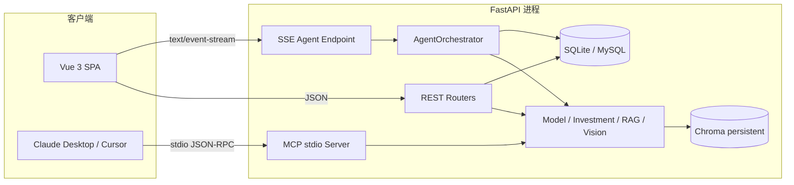
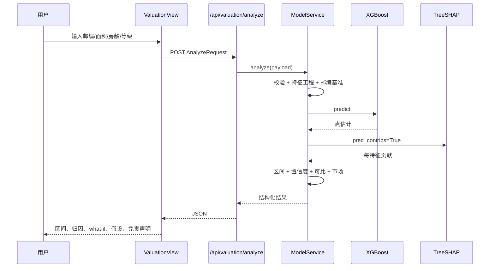

# HouseMind AI — 架构与技术决策

> 版本 1.0.0 · 2026-11 · 面向竞赛评审与二次开发

## 1. 设计目标

HouseMind AI 要同时满足三个约束：

1. **可验证**：每个价格、贡献值、现金流和回答都能回到数据、模型或来源。
2. **可降级**：没有 DeepSeek / Vision API 密钥时，系统仍能完整演示，但必须诚实标注当前模式。
3. **可解释**：用户看到的不是“AI 说”，而是“模型 + 区间 + 归因 + 假设 + 引用”。

因此架构不是“前端 + 一个大模型”，而是 **共享服务层 + 两条入口**：网页 API 与 MCP 工具协议共享同一套业务能力；Agent 只是服务层之上的编排器。

## 2. 总览



### 进程模型

- 单进程 Uvicorn，启动时加载 XGBoost、构建/加载 Chroma 索引、初始化 SQLite 表。
- 模型与索引为进程内单例；生产部署建议 1–2 workers，避免重复加载大模型。
- 前端构建产物由 FastAPI 直接托管，单端口即可演示；开发时 Vite 5173 代理 `/api`。

## 3. 目录与职责

| 路径 | 职责 |
|---|---|
| `backend/main.py` | lifespan、CORS、安全头、路由挂载、SPA fallback |
| `backend/app/core/config.py` | 环境变量、路径、模型/密钥配置 |
| `backend/app/core/database.py` | SQLAlchemy 模型与会话 |
| `backend/app/core/security.py` | 注入检测、输出清洗、PII、限流、canary |
| `backend/app/services/model_service.py` | 估值、区间、SHAP、市场、what-if、可比 |
| `backend/app/services/investment_service.py` | 月供、NOI、DSCR、IRR、情景、敏感性 |
| `backend/app/rag/engine.py` | 文档切分、哈希向量、BM25、混合排序、抽取式回答 |
| `backend/app/services/vision_service.py` | Pillow 本地信号 + 可选远程 VLM |
| `backend/app/agent/tools.py` | 6 个工具 schema、别名、参数强制转换 |
| `backend/app/agent/orchestrator.py` | SSE、DeepSeek loop、本地规划器、持久化 |
| `backend/app/api/*.py` | REST 路由与请求/响应模型 |
| `backend/mcp_server.py` | 官方 FastMCP stdio server |
| `frontend/src/views/*.vue` | 7 个页面 |
| `frontend/src/components/*` | 设计系统、图表、Markdown、工具轨迹 |
| `ml/*.py` | 训练、解释、评测、泛化、RAG gold set |

## 4. 请求链路

### 4.1 估值



关键点：

- 请求模型使用 Pydantic 做范围校验（面积、卧室、等级、邮编格式）。
- 所有特征工程在 `ModelService` 内复用 `ml/common.py` 的逻辑，避免训练/推理漂移。
- 估值结果包含 `confidence`（基于区间宽度、邮编样本量、特征完整度等）与 `warnings`。
- 单次请求同时返回点估计、P10/P90、SHAP、市场与可比，前端无需二次拼装。

### 4.2 Agent SSE

事件顺序：

```
event: meta        {conversation_id, mode, guard}
event: status      {stage, label}
event: tool_call   {name, label, arguments, reason}
event: tool_result {name, summary, latency_ms, data}
event: token       {text}
event: citations   [{index, title, section, source_url}]
event: done        {message_id, conversation_id, mode, suggestions}
```

- `meta` 先返回会话 ID，前端可立即建立可分享链接。
- 工具结果先于自然语言，保证“先算再说”。
- 历史消息把工具摘要写入 `meta.tool_records`，刷新后仍可展开轨迹。
- 任何工具异常发送 `tool_error`，编排器继续用其余结果合成，不因单点失败中断。

### 4.3 RAG

```
query
  → normalise
  → 字符 n-gram 哈希向量（512d）+ BM25（原词/同义词扩展）
  → min-max 归一 + 领域词加权 + 标题覆盖
  → 每文档最多 2 个片段（多样性）
  → 主题门槛：查询特定术语必须命中，否则拒答
  → 本地抽取式回答（可选 DeepSeek 生成）
  → citations
```

## 5. 数据与模型边界

### 5.1 三个数据集完全隔离

| 数据集 | 用途 | 目标 | 单位 |
|---|---|---|---|
| King County | 主估值模型、驾驶舱、投资案例 | 成交价 | USD |
| UCI 新店区 | 小样本独立验证、距离/年龄关系 | 单位面积房价 | 万元新台币/坪 |
| California | 区域模型对照、封顶偏差讨论 | 街区中位房价 | USD（1990） |

- 不拼接训练，不取指标平均。
- UCI 与 California 只出现在研究页，不进入主估值 API。
- 主模型输出永远带 “King County 2014–2015” 范围提示。

### 5.2 防泄漏

- 训练/测试固定 80/20，`random_state=42`。
- 邮编基准价 `zip_market_value` **只在训练集** `build_zip_stats(train_raw)` 上计算，再映射到测试集与新请求。
- 未见邮编回退到全局邮编中位数，并在泛化实验中单独报告冷启动误差。
- 区间校准使用训练集内部的 5 折 OOF 残差，不触碰测试集。
- 超参数早停使用训练集内部验证，测试集只做最终评估。

### 5.3 可解释性

- 使用 XGBoost 原生 `booster.predict(pred_contribs=True)` 得到精确 TreeSHAP。
- 不依赖 `shap` 包的模型转换，规避版本差异导致的字符串/数组解析错误。
- 加性校验：`base_value + sum(contributions) ≈ prediction`，测试中固定断言。
- 全局重要性由测试集平均绝对贡献计算；局部解释只展示 Top 8 + 其他。

## 6. 前端工程

### 6.1 技术栈

- Vue 3.5 `<script setup>` + TypeScript strict。
- Vite 7 构建；Vue Router 4；Pinia 3。
- ECharts 5 按需引入；`markRaw` 避免图表实例被响应式代理。
- 自研设计系统：CSS variables + 组件，不引入 Element Plus。
- 字体：Fraunces Variable（标题衬线）+ Manrope Variable（正文/数字），本地打包，不依赖 Google Fonts。

### 6.2 设计语言

- 深墨绿 `#10231d`、暖沙 `#f5f0e6`、黄铜 `#b08a52`，低饱和、编辑感。
- 页面结构：`PageHeader`（kicker / 大标题 / lede / meta）+ 内容网格。
- 数字使用等宽数字特性与细分隔线，强调“报告”而非“后台表格”。
- 负现金流用暖红，不用警报红；避免把市场事实道德化。
- 移动端：侧栏抽屉、表格横向滚动、图表高度压缩、知识库管线 2 列。

### 6.3 状态与错误

- `useAppStore` 保存健康状态、模型元信息、模式。
- `useAnalysisStore` 在页面间传递最近一次估值，支持“带到投资/Agent”。
- API 客户端统一抛出后端 `detail`，页面用 toast 呈现，不吞错。
- 图表 `ResizeObserver` 自适应；路由切换时销毁实例。
- SSE 使用 `fetch` + `ReadableStream` 手动解析，支持中止与错误帧。

## 7. 持久化

| 表 | 用途 |
|---|---|
| `conversations` | 会话标题、模式、时间 |
| `messages` | 用户/助手消息、Markdown、meta（引用、工具摘要） |
| `tool_events` | 工具名、参数、摘要、耗时，用于审计 |
| `saved_analyses` | 保存的估值/投资报告 |

- SQLite 默认路径 `backend/data/housemind.db`，启动自动建表。
- MySQL 只需改 `DATABASE_URL`，使用 `PyMySQL` 驱动。
- 上传文件保存到 `backend/data/uploads`，EXIF 在入库前移除；原图不长期保留策略由部署方决定。

## 8. 安全

| 风险 | 措施 |
|---|---|
| 提示词注入 | 中英文模式匹配、严重级别、直接阻止或降级模板回答 |
| 系统提示泄漏 | canary 字符串检测 + 输出清洗 |
| XSS | 前端 Markdown 经 DOMPurify；后端移除 `<script>` 等标签 |
| PII | 手机号、邮箱、SSN 样式脱敏后入库 |
| 滥用 | 进程内滑动窗口限流（默认 30 次/分钟） |
| 上传 | MIME + Pillow 双重校验、大小限制、EXIF 移除、随机文件名 |
| 密钥 | 仅环境变量；`.env` 被 gitignore；仓库无硬编码密钥 |
| 响应头 | `X-Content-Type-Options`、`X-Frame-Options`、`Referrer-Policy` 等 |

## 9. 性能

实测（本机，Apple Silicon，单进程）：

| 操作 | 耗时 |
|---|---|
| 模型 + RAG 冷启动 | ~1.6 s |
| 单次估值 + SHAP + 市场 + 可比 | ~30–50 ms |
| 投资测算 + 敏感性 | <10 ms |
| RAG 检索（71 片段） | <10 ms |
| 本地 Agent 4 工具 + 报告 | ~4–6 s（含逐字动画） |

优化手段：

- 模型、训练集、邮编统计在启动时加载一次。
- Chroma 持久化；文档指纹未变时复用索引。
- 驾驶舱数据预计算为 JSON，不在请求时聚合 2 万行。
- 前端路由懒加载，ECharts 按需注册。

## 10. 部署

### 单机

```bash
./scripts/start.sh
```

### Docker

```bash
docker compose up --build
```

- 多阶段构建：Node 构建 SPA → Python 运行时。
- 运行镜像包含模型、知识库、数据集与前端产物。
- `housemind-data` volume 持久化 SQLite、Chroma 与上传。
- 健康检查 `GET /api/health`。

### 反向代理要点

- SSE 需关闭缓冲：Nginx `proxy_buffering off; proxy_read_timeout 300s;`。
- 上传限制至少 8 MB。
- 生产设置 `APP_ENV=production`，限制 `CORS_ORIGINS`，不要暴露 `/docs`（可按需关闭）。

## 11. 测试策略

- **API 合约**：估值字段、SHAP 加性、投资数学、RAG、上传、SSE。
- **安全**：注入、canary、PII、HTML 清洗。
- **模型**：artifact 指标存在、预测确定性。
- **端到端**：`TestClient` 启动完整 lifespan，避免只测函数不测装配。
- **前端**：`vue-tsc` 严格类型检查；桌面/移动 DOM 检查无横向溢出与破图。

## 12. 取舍与后续

| 取舍 | 原因 | 后续 |
|---|---|---|
| 本地字符哈希 embedding | 零依赖、可离线、演示稳定 | 可替换 OpenAI/BGE embedding，保留同一接口 |
| 本地规划器 | 无密钥也能完整演示 | 有密钥时无缝切换 Function Calling |
| Pillow 视觉信号 | 不假装语义理解 | 远程 VLM 仅做可见描述，不替代检查 |
| 单进程 | 演示简单 | 生产可拆模型服务与 API，加 Redis 限流 |
| SQLite | 零配置 | MySQL 已支持，适合多用户部署 |

---

更多模型细节见 [AI_TECHNICAL.md](AI_TECHNICAL.md)，创新点见 [INNOVATION.md](INNOVATION.md)。
