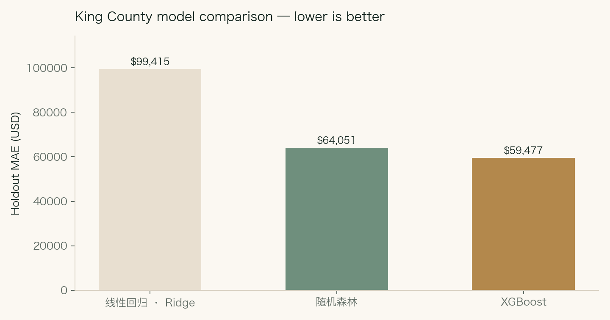
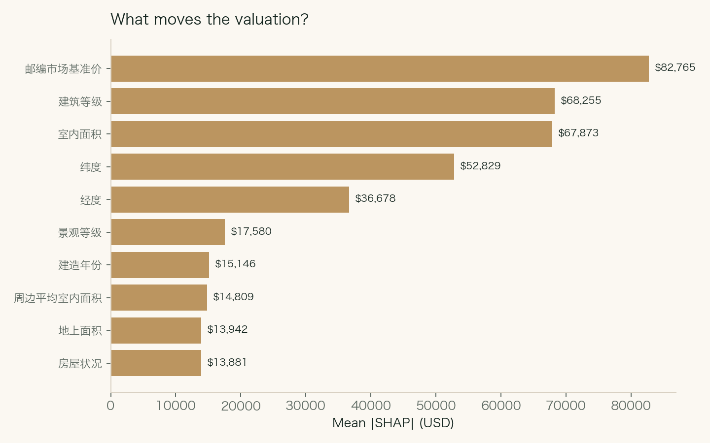

# HouseMind AI 实验结果摘要

> 以下数字均由 `ml/train.py` 在本地真实数据上运行生成，可通过重新运行脚本复现。

## 主实验：King County

- 数据：21,613 条原始记录 → 21,418 条清洗后记录
- 划分：80/20 random holdout, random_state=42
- 最终模型：XGBoost，1200 轮提升树
- 测试集 MAE：**$59,477**
- 测试集 RMSE：**$100,986**
- 测试集 R²：**0.9156**
- 相对 Ridge 基线 MAE 降低：**40.2%**
- 80% 区间：$-90,228 ~ +$86,242；测试集覆盖率 81.5%

## 外部实验

| 数据集 | 目标 | 留出集 MAE | R² | 说明 |
|---|---|---:|---:|---|
| UCI Real Estate | 单位面积房价（万元新台币/坪） | 3.7 | 0.8305 | 414 条，独立市场，不可与 King County 直接比较 |
| California Housing | 街区组房价中位数（USD） | $29,383 | 0.8472 | 1990 年普查，目标在 500,001 美元封顶 |

## 误差切片

| 价格带 | 样本数 | MAE | MAPE |
|---|---:|---:|---:|
| <300k | 179 | $37,819 | 16.67% |
| 300-500k | 292 | $41,427 | 10.51% |
| 500-750k | 202 | $61,329 | 10.08% |
| 750k-1M | 70 | $74,390 | 8.87% |
| 1-2M | 46 | $194,284 | 14.71% |
| 2M+ | 11 | $253,238 | 10.46% |

